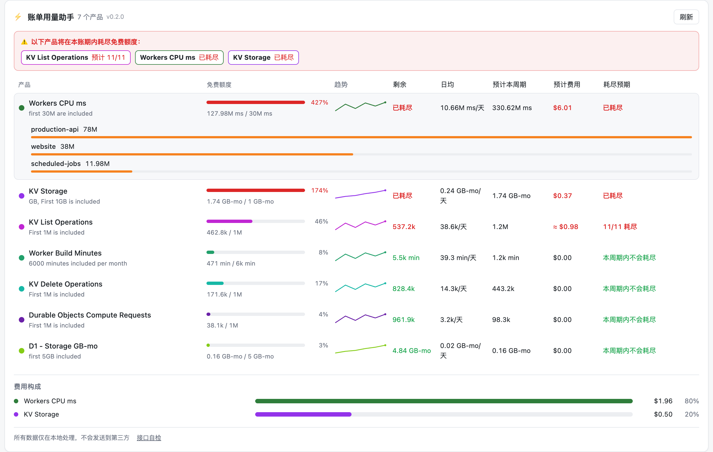

# Billing Helper for Cloudflare®

Billing Helper for Cloudflare® 是一个包含两个客户端的 monorepo：浏览器扩展增强 Cloudflare® 账单页面，macOS 菜单栏应用汇总账户费用与账期预估。两端共享计费产品目录和测试样例。

- `apps/extension/`：WXT + Vue 浏览器扩展。
- `apps/macos/`：Swift macOS 菜单栏应用。
- `packages/billing-spec/`：共享产品目录与计费样例。

项目主页：<https://meathill.com/cloudflare-billing-helper> · [English](https://meathill.com/en/cloudflare-billing-helper)

## 浏览器扩展



### 解决的问题

Cloudflare 账单页只告诉你「用了多少、花了多少」，但不告诉你：

1. **免费额度还剩多少** —— 每个产品都有一行进度条和剩余量，超过 70% 变黄、超量变红；
2. **什么时候会耗光** —— 按日均（请求类）或存储趋势（GB-months 类）外推，直接给出预计耗尽日期，方便你在 KV → R2 这类迁移上提前决策；
3. **预计要花多少钱** —— 逐产品外推本周期用量与费用；本周期还没产生费用的产品用官方目录价估算（标 `≈`）；
4. **钱花在哪个应用上** —— 展开产品行，利用你的登录态调用 dashboard 内部接口，把总量拆到具体的 Worker / KV namespace / D1 数据库 / R2 bucket / Durable Object。

另外每个产品行还内嵌一条每日用量趋势线（基于扩展每天自存的本机快照），用量翻倍或腰斩的日子会直接标红点。

### 功能一览

| 功能 | 说明 |
| --- | --- |
| 免费额度进度 | 29 个计费行全覆盖，额度内/预警/超量三色状态 |
| 耗尽预警 | 面板顶部汇总「本周期将耗尽」的产品及日期，列表按紧急程度排序 |
| 逐产品预估 | 日均用量、预计周期用量、预计超额费用（页面费率优先，缺失时用官方目录价并标 `≈`） |
| 按应用拆分 | Workers / KV / D1 / R2 / Durable Objects 五族，按消耗降序展示占比 |
| 行内趋势 | 每个产品内嵌每日用量迷你折线（扩展本地留存快照），翻倍 / 腰斩自动标红点，悬停可看最近一天数值 |
| 隐私 | 全部数据仅在本地处理，只访问 `dash.cloudflare.com` 自身，不经过任何第三方 |

### 安装

可直接[下载 Chrome / Edge 扩展安装包](https://i.meathill.com/downloads/cloudflare-billing-helper/extension/0.2.0/cloudflare-billing-helper-0.2.0-chrome.zip)，解压后按下方步骤加载，无需安装开发工具。Chrome Web Store 上架准备中。

从源码构建：

```bash
git clone https://github.com/meathill/cloudflare-billing-helper.git
cd cloudflare-billing-helper
pnpm install
pnpm build          # 兼容安装路径 .output/chrome-mv3，主产物在 apps/extension/.output/chrome-mv3
```

1. 打开 `chrome://extensions`，开启「开发者模式」；
2. 点「加载已解压的扩展程序」，选择解压后包含 `manifest.json` 的目录；从源码构建则选择 `.output/chrome-mv3`；
3. 打开 [Cloudflare Dashboard → 账单 → 可计费使用量](https://dash.cloudflare.com/)（`/{accountId}/billing/billable-usage`），面板会出现在「支出摘要」下方。

**升级**：保留原 `.output/chrome-mv3` 安装路径以沿用扩展 ID 和本地数据。`pnpm build` → 扩展页点刷新 → 账单页整页刷新。面板标题栏与控制台会显示版本号。

### 使用说明

- 鼠标悬停 `≈` 费用可查看估算依据；展开产品行查看按应用拆分，结果缓存 10 分钟；
- 页脚「接口自检」会逐项探测拆分接口在当前账号下是否可用，失败项会显示原始错误（便于反馈校准）；
- 每个账期首次打开起，扩展每天记录一次快照（用量与费用两个维度），趋势线需要积累 2 天以上数据；账期切换时曲线重新起算，不与上一账期混算。

## macOS 应用

可直接[下载 Mac 通用安装包](https://i.meathill.com/downloads/cloudflare-billing-helper/macos/1.0.0-5/billing-helper-for-cloudflare-1.0.0-5-universal.dmg)，适用于 macOS 13 或更新版本的 Apple Silicon 与 Intel Mac。打开镜像后将应用拖入 Applications；应用已通过 Developer ID 签名与 Apple 公证。

主窗口使用侧栏组织费用概览、账户、预算提醒、应用设置和关于；支持系统深浅色外观，以及 ⌘1–⌘5 切换页面、⌘0 打开或聚焦主窗口。关于页介绍产品作者肉山（Meathill）；官网下载版提供自愿的 [Buy Me a Coffee 支持链接](https://buymeacoffee.com/meathill)，App Store 版保留 StoreKit 内购。支持均不解锁功能。

需要 Xcode 和 macOS SDK。构建并启动：

```bash
pnpm build:macos
open apps/macos/build/DerivedData/Build/Products/Debug/CloudflareBillingHelper.app
# 启动时打开 Settings，并保留真实账户模式
open apps/macos/build/DerivedData/Build/Products/Debug/CloudflareBillingHelper.app --args --show-settings
```

连接账户时，在账户页点击创建只读 Token 的链接，在 Cloudflare 确认 Account > Billing > Read、Account > Account Settings > Read、Zone > Zone > Read 三项权限并创建令牌；链接默认预选所有账户和域名，可按需缩小资源范围。将 Token 直接粘贴到本机应用的安全输入框，读取账户后勾选添加。高级设置仍支持手动输入账户 ID 和 Token。添加账户后应用单独检查账单权限和费用；读取期间显示中性状态。费用概览页可选择当前账户、刷新账单并查看数据不完整的原因。

应用汇总固定订阅与按量费用，并基于可用数据估算账期费用。费用概览显示账期进度、当前费用与期末预测；累计按量费用折线展示账期内可用的总趋势；当产品数据日期无法同步合成总趋势时，可选择查看单个产品的累计费用趋势。产品条形图表示各产品占已知按量费用的比例，并非免费额度使用率；数据不完整或不能计算占比时会明确提示。按量费用取完整维度的最新累计值，保留原始日记录，产品小计使用相同口径。缓存超过 6 小时会标记为过期，并在应用运行时按刷新策略更新。Cloudflare 官方 MCP 项目说明其 OAuth 授权不提供账单访问，见 [Refused API calls](https://github.com/cloudflare/mcp/blob/main/AGENTS.md#refused-api-calls)；本应用使用只读 Token。内部隔离的设计预览、构建和归档说明见 [macOS 构建文档](docs/macos/build.md)。

## 隐私

- 扩展使用浏览器会话 cookie 访问 `dash.cloudflare.com` 的账单和用量接口；缓存与快照保存在浏览器本地存储。
- macOS 应用使用只读 Token 直接访问 Cloudflare API；Token 存放在系统钥匙串中。内部 DesignPreview 使用隔离的模拟数据，不属于正式应用用户流程。
- 两端均不发送第三方遥测。

## 开发

```bash
pnpm dev                  # 开发模式（热更新）
pnpm build                # 生产构建，不修改版本
pnpm version:extension    # 手动调升扩展 patch 版本
pnpm test                 # 扩展与 macOS 测试
pnpm test:extension       # 扩展 Vitest 测试
pnpm test:macos           # Swift 测试
pnpm build:macos          # 构建 macOS 应用
pnpm compile              # vue-tsc 类型检查
pnpm --filter @cloudflare-billing-helper/extension build:screenshots # 独立截图构建
pnpm repro                # 真实 Chromium 加载扩展跑六个挂载场景
pnpm screenshots          # 生成中英文截图（含商店 1280×800）
node apps/extension/scripts/make-icons.mjs # 重新生成图标
pnpm promo                # 生成商店宣传图（440×280 / 1400×560）
```

商店上架文案与表单答案见 [`docs/store-listing.md`](docs/store-listing.md)。验证范围和待验收项目见 [`docs/verification.md`](docs/verification.md)。

扩展技术栈：WXT + Vue 3 + TypeScript + 自绘 SVG 图表（无图表库）。

```
apps/extension/entrypoints/
  injected.content.ts   # MAIN-world：转发 SPA 路由变化、捕获账单接口 JSON
  content.ts            # ISOLATED：Shadow DOM 挂载面板，等表格渲染后插入、被移除自动重挂
  content/              # Vue 面板与组件（QuotaTable / BreakdownList / 图表）
apps/extension/lib/
  products.ts           # 29 个计费行目录：免费额度、单位、颜色、产品族、官方目录价
  math.ts               # 日均/外推/耗尽日期/回归（纯函数）
  sort.ts               # 预警优先排序
  parse/dom-parser.ts   # 页面表格解析（中英文界面兼容）
  api/                  # dash GraphQL/REST：Workers/KV/D1/R2/DO 拆分与自检
  cache.ts              # session 缓存 + 每日快照
apps/extension/tests/   # vitest
packages/billing-spec/  # 双端共享产品目录与计费样例
apps/macos/             # macOS 客户端
```

### 扩展已知限制

- 拆分依赖 dashboard 内部 GraphQL 数据集，R2/DO/D1 的字段名未全部见于公开文档，个别维度可能暂不可用（行内会降级提示，可用「接口自检」定位）；
- GB-months 为账期内日均字节的估算口径，与计费口径基本一致；
- 仅支持 Cloudflare Workers Paid 账户的 self-serve 计费页。

## License

Private project, all rights reserved.
