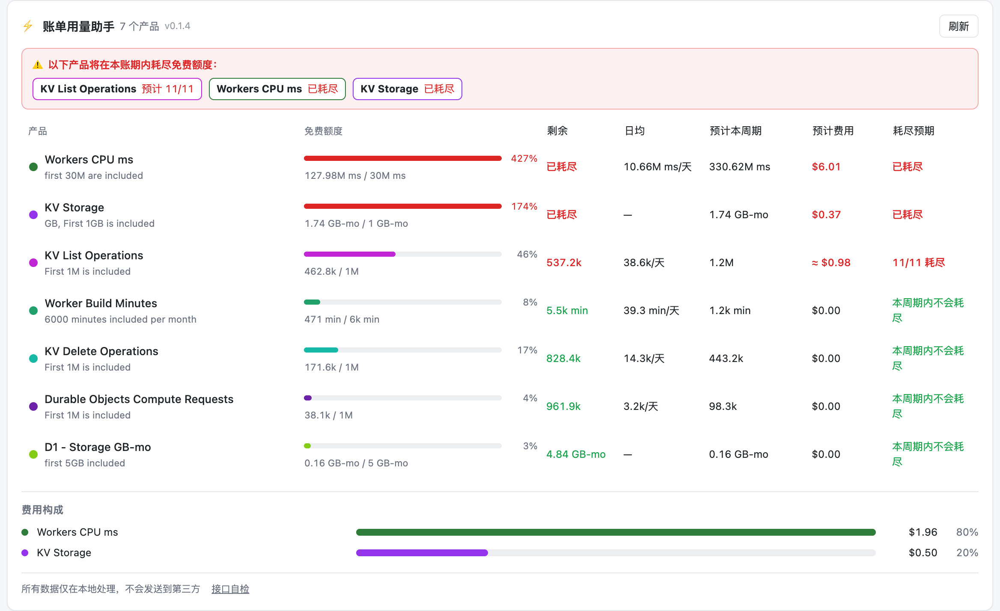

# Cloudflare Billing Helper

> 把 Cloudflare「可计费使用量」页面变成一张看得懂的配额驾驶舱：
> **免费额度还剩多少、什么时候会耗尽、预计花多少钱、钱花在哪个 Worker / namespace 上。**

项目主页：<https://meathill.com/cloudflare-billing-helper> · [English](https://meathill.com/en/cloudflare-billing-helper)



## 解决的问题

Cloudflare 账单页只告诉你「用了多少、花了多少」，但不告诉你：

1. **免费额度还剩多少** —— 每个产品都有一行进度条和剩余量，超过 70% 变黄、超量变红；
2. **什么时候会耗光** —— 按日均（请求类）或存储趋势（GB-months 类）外推，直接给出预计耗尽日期，方便你在 KV → R2 这类迁移上提前决策；
3. **预计要花多少钱** —— 逐产品外推本周期用量与费用；本周期还没产生费用的产品用官方目录价估算（标 `≈`）；
4. **钱花在哪个应用上** —— 展开产品行，利用你的登录态调用 dashboard 内部接口，把总量拆到具体的 Worker / KV namespace / D1 数据库 / R2 bucket / Durable Object。

另外还有费用构成条形图、额度消耗趋势折线图（基于扩展每天自存的快照）。

## 功能一览

| 功能 | 说明 |
| --- | --- |
| 免费额度进度 | 29 个计费行全覆盖，额度内/预警/超量三色状态 |
| 耗尽预警 | 面板顶部汇总「本周期将耗尽」的产品及日期，列表按紧急程度排序 |
| 逐产品预估 | 日均用量、预计周期用量、预计超额费用（页面费率优先，缺失时用官方目录价并标 `≈`） |
| 按应用拆分 | Workers / KV / D1 / R2 / Durable Objects 五族，按消耗降序展示占比 |
| 趋势图 | 每日额度消耗曲线（扩展本地留存快照，保留 3 个账期） |
| 隐私 | 全部数据仅在本地处理，只访问 `dash.cloudflare.com` 自身，不经过任何第三方 |

## 安装

> Chrome Web Store 上架准备中。目前可用「加载已解压的扩展」方式安装。

```bash
git clone https://github.com/meathill/cloudflare-billing-helper.git
cd cloudflare-billing-helper
pnpm install
pnpm build          # 产物在 .output/chrome-mv3
```

1. 打开 `chrome://extensions`，开启「开发者模式」；
2. 点「加载已解压的扩展程序」，选择 `.output/chrome-mv3`；
3. 打开 [Cloudflare Dashboard → 账单 → 可计费使用量](https://dash.cloudflare.com/)（`/{accountId}/billing/billable-usage`），面板会出现在「支出摘要」下方。

**升级**：`pnpm build`（自动 +1 patch 版本）→ 扩展页点刷新 → 账单页整页刷新。面板标题栏与控制台会显示版本号。

## 使用说明

- 鼠标悬停 `≈` 费用可查看估算依据；展开产品行查看按应用拆分，结果缓存 10 分钟；
- 页脚「接口自检」会逐项探测拆分接口在当前账号下是否可用，失败项会显示原始错误（便于反馈校准）；
- 每个账期首次打开起，扩展每天记录一次用量快照，趋势图需要积累 2 天以上数据。

## 隐私

- 无任何远程请求：不发送遥测，不加载第三方脚本；
- 仅使用浏览器会话 cookie 访问 `dash.cloudflare.com` 内部接口读取你自己的账单与用量数据；
- 缓存与快照保存在 `chrome.storage` 本地，最多保留 3 个账期。

## 开发

```bash
pnpm dev                  # 开发模式（热更新）
pnpm build                # 生产构建（自动调升 patch 版本）
pnpm build:only           # 只构建，不改版本
pnpm test                 # vitest：预估算法、DOM 解析、排序、目录价（43 例）
pnpm compile              # vue-tsc 类型检查
node scripts/repro.mjs    # 真实 Chromium 加载扩展跑六个挂载场景
node scripts/screenshots.mjs  # 生成文档截图
node scripts/make-icons.mjs   # 重新生成图标
```

技术栈：WXT + Vue 3 + TypeScript + 自绘 SVG 图表（无图表库）。

```
entrypoints/
  injected.content.ts   # MAIN-world：转发 SPA 路由变化、捕获账单接口 JSON
  content.ts            # ISOLATED：Shadow DOM 挂载面板，等表格渲染后插入、被移除自动重挂
  content/              # Vue 面板与组件（QuotaTable / BreakdownList / 图表）
lib/
  products.ts           # 29 个计费行目录：免费额度、单位、颜色、产品族、官方目录价
  math.ts               # 日均/外推/耗尽日期/回归（纯函数）
  sort.ts               # 预警优先排序
  parse/dom-parser.ts   # 页面表格解析（中英文界面兼容）
  api/                  # dash GraphQL/REST：Workers/KV/D1/R2/DO 拆分与自检
  cache.ts              # session 缓存 + 每日快照
tests/                  # vitest
```

## 已知限制

- 拆分依赖 dashboard 内部 GraphQL 数据集，R2/DO/D1 的字段名未全部见于公开文档，个别维度可能暂不可用（行内会降级提示，可用「接口自检」定位）；
- GB-months 为账期内日均字节的估算口径，与计费口径基本一致；
- 仅支持 Cloudflare Workers Paid 账户的 self-serve 计费页。

## License

Private project, all rights reserved.
